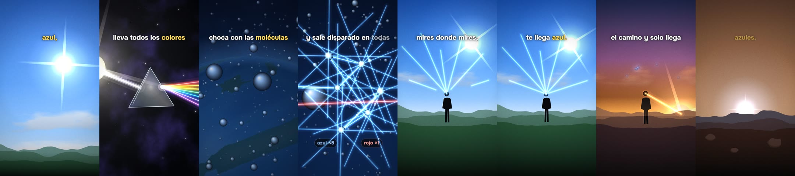

# Animados · vídeos animados con Claude y ChatGPT

**Una voz cuenta algo sorprendente y en pantalla pasa lo que dice:** dibujado en código, grande, con luz, cámara y movimiento en cada palabra. Para Reels, Shorts y TikTok. Código abierto de IA que trabaja.

[Guía paso a paso](https://tools.iaquetrabaja.com/videos-con-claude/) · [Descargar](https://github.com/iaquetrabaja/skill-animados/releases/latest) · [Licencia MIT](LICENSE)



[Ver la demo: «¿Por qué el cielo es azul?» (33 s)](https://github.com/iaquetrabaja/skill-animados/releases/latest/download/demo.mp4)

## Empieza

Descarga el ZIP, descomprímelo y abre la carpeta en **Claude Code o Codex**. Pega:

```
Lee AGENTS.md y SKILL.md. Comprueba los requisitos sin instalar modelos de voz. Enséñame la demo y después haz un vídeo vertical sobre [TEMA] para [PÚBLICO]. Cada frase tiene que ser algo que pasa en pantalla, grande y con luz: nada de diapositivas. Enséñame primero el gancho.
```

## Qué trae la versión 3

- **Un motor de dibujo propio** (`plantilla/src/motor/`): cámara 3D con paralaje, estrellas y nebulosas, planetas con textura que giran (Tierra, Marte, Luna, gaseosos), cielo según la altura del Sol, nubes, colinas, personas, prisma y espectro, haces de luz, brillos, partículas en 3D, chispas, gráficos que se dibujan, un móvil, cifras, viñeta y grano. Mira la lámina: [`docs/kit.jpg`](docs/kit.jpg).
- **Subtítulos palabra a palabra** con la palabra clave en color, sin cajas ni títulos que repitan la voz.
- **Un método por planos:** sitios, cámara que se mueve con la voz, cortes solo para cambiar de sitio y el gancho primero (`referencias/02-planos.md`).
- **Una medida de movimiento** que no deja dar por bueno un vídeo quieto: si más del 30 % está quieto, el primer segundo está quieto o hay 1,5 s sin cambios, no pasa (`herramientas/movimiento.py`). La demo anterior no la pasaba (75 % quieta); la nueva, sí (8 %).

## Instalación manual

Necesitas **Node.js 22+**, **Python 3.10+** y **FFmpeg** en el PATH. Para la demo no hace falta GPU, API ni modelo de voz.

```bash
git clone https://github.com/iaquetrabaja/skill-animados.git
cd skill-animados
python herramientas/animados.py doctor
python herramientas/animados.py instalar
python herramientas/animados.py demo
```

Resultado: `salida/demo.mp4`, 1080 × 1920, 30 fps. Para moverte por ella: `python herramientas/animados.py preview` y elige `Demo`.

Un vídeo tuyo:

```bash
python herramientas/animados.py crear mi-video
python herramientas/animados.py instalar proyectos/mi-video/plantilla
python herramientas/animados.py preview proyectos/mi-video/plantilla
python herramientas/animados.py render proyectos/mi-video/plantilla
```

La plantilla trae un plano de ejemplo y voz muda. Sustituye `public/voz.wav`, saca los tiempos y escribe tus planos en `src/video/planos.ts`.

## La voz

1. **Tu grabación:** un WAV limpio. Sin GPU ni servicios externos.
2. **AI33/OpenSpeaker:** voces de ElevenLabs, Minimax y otros con tu cuenta y tu clave (`AI33_API_KEY`). [Guía](referencias/08-ai33.md). Consume créditos.
3. **Qwen local:** con una muestra de voz autorizada y su texto. Descarga varios GB y no se instala sola.

```bash
python herramientas/palabras.py plantilla/public/voz.wav plantilla/public/cues.json --guion guion.txt
```

Whisper saca el segundo de cada palabra. Si una palabra no coincide, se para; `--permitir-estimados` la interpola y la marca para revisarla.

## Revisar

- `python herramientas/movimiento.py salida/video.mp4`: la medida de movimiento (también corre sola al renderizar).
- `python herramientas/revisa.py salida/video.mp4`: una hoja con un fotograma cada medio segundo.
- Lo que hay que buscar está en [`referencias/05-revisar.md`](referencias/05-revisar.md). Reproduce los cortes y escucha la voz entera.
- Pruebas del taller: `python -m unittest discover -s tests`. Tipos: `cd plantilla && npm run check`.

## Licencias

Código, instrucciones y demo de IA que trabaja, con licencia MIT. La letra Onest es OFL (`plantilla/public/letra/OFL.txt`). Remotion 4 tiene [licencia propia](https://www.remotion.dev/license): gratis para particulares y empresas de hasta tres personas. La demo usa la voz `elevenlabs_7QXA3lh7d25G1SzsIJdv` de AI33 a velocidad 1; la clave no se incluye. Las fuentes de los datos están en `ejemplos/cielo-azul/investigacion.md`. La animación es una ilustración, no una simulación física.

[Problemas y propuestas](https://github.com/iaquetrabaja/skill-animados/issues) · [IA que trabaja](https://iaquetrabaja.com)
