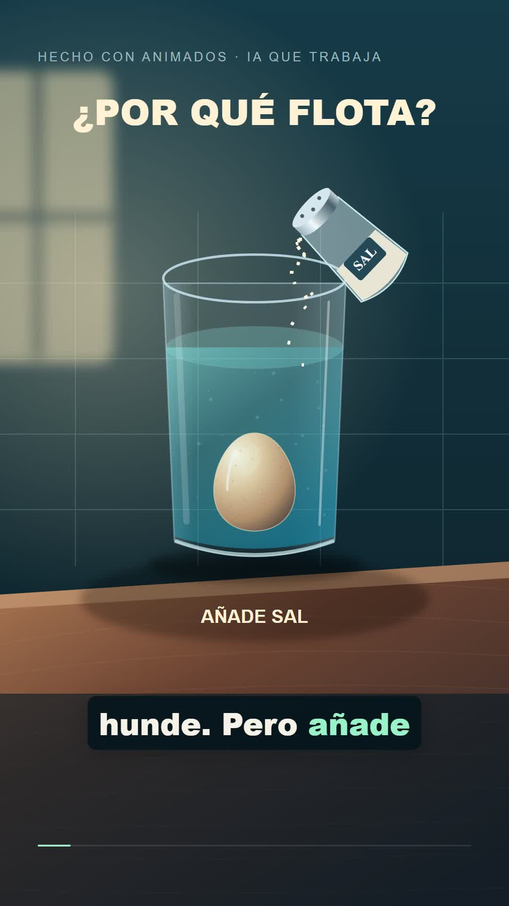

# Animados · vídeos con Claude y ChatGPT

**De una idea a un vídeo animado editable**, con guion, voz, subtítulos y revisión. Código abierto de IA que trabaja. No necesitas comprar el curso de ninguna otra persona para usarlo.

[Guía paso a paso](https://tools.iaquetrabaja.com/videos-con-claude/) · [Descargar](https://github.com/iaquetrabaja/skill-animados/releases/latest) · [Licencia MIT](LICENSE)

## Empieza sin pelearte con comandos

Descarga el ZIP del repositorio, descomprímelo y abre esa carpeta en **Claude Code o Codex**. Pega:

> Lee AGENTS.md y SKILL.md. Comprueba los requisitos sin instalar modelos de voz. Enséñame primero la demo incluida y después crea un vídeo vertical de 30 segundos sobre [TEMA], para [PÚBLICO]. Quiero una acción visual que explique cada idea, no una sucesión de tarjetas. Hazlo en una carpeta nueva, valida y revisa el resultado.

**ChatGPT en el navegador:** adjunta `SKILL.md` y las referencias relevantes para preparar investigación, guion y storyboard. Para ejecutar el proyecto en tu ordenador usa Codex, Claude Code o los comandos de abajo. Adjuntar instrucciones no concede acceso a tu PC. [Compatibilidad y prompts](referencias/06-asistentes.md).



[Ver o descargar la demo narrada de unos 28 segundos](https://github.com/iaquetrabaja/skill-animados/releases/latest/download/demo.mp4)

## Qué mejora la versión 2

- Un taller portable: comprobar requisitos, crear proyectos aislados, validar, previsualizar y exportar.
- `AGENTS.md` y `CLAUDE.md` comparten el mismo método; no dependes de un solo asistente.
- Kit SVG propio con volumen, sombra de contacto, trayectorias con destino y estallidos deterministas. Demo original narrada de unos 28 segundos.
- Subtítulos sin descarga de Google Fonts durante el render; se elimina el zoom continuo que podía recortar el dibujo.
- La alineación rechaza palabras no reconocidas por defecto. Si decides interpolar, queda identificado en el JSON.
- Se comprueban tiempos negativos, solapes, orden de escenas, palabras inexistentes y TypeScript.
- Revisión con hojas de contacto y comprobación en movimiento. Los PNG temporales se eliminan al terminar.
- Pruebas automáticas en GitHub. Modelos, claves, voces personales y proyectos privados quedan fuera del paquete.
- Tres efectos originales reproducibles sin descargas y mezcla opcional con música que baja bajo la voz (`herramientas/audio.py`).

## Instalación manual

Necesitas **Node.js 22 LTS**, **Python 3.10+** y **FFmpeg/ffprobe** en PATH. Para la demo no necesitas Python de IA, API, GPU ni un modelo de voz. La exportación puede descargar el navegador de render la primera vez.

```bash
git clone https://github.com/iaquetrabaja/skill-animados.git
cd skill-animados
python herramientas/animados.py doctor
python herramientas/animados.py instalar
python herramientas/animados.py demo
```

Resultado: `salida/demo.mp4`, 1080 × 1920, 30 fps, **con narración generada en local y efectos originales**. Explica por qué un huevo flota al añadir sal, mediante ocho escenas. La narración final está incluida; no necesitas clonar una voz ni descargar un modelo para renderizar la demo. Para verlo editable: `python herramientas/animados.py preview` y elige `Demo`.

```bash
python herramientas/animados.py crear mi-video
python herramientas/animados.py instalar proyectos/mi-video/plantilla
python herramientas/animados.py validar proyectos/mi-video/plantilla
python herramientas/animados.py preview proyectos/mi-video/plantilla
python herramientas/animados.py render proyectos/mi-video/plantilla
```

La plantilla de la lata trae **voz silenciosa y tiempos de muestra**. Antes de publicar un vídeo real sustituye `public/voz.wav`, genera los tiempos y adapta `src/escenas.tsx`. Los ejemplos metro/boli son referencias de escenas, no vídeos listos con narración. No se sobrescriben proyectos existentes.

## Voz: elige el camino sencillo primero

1. **Grabación propia:** usa tu WAV; no necesita GPU ni servicio externo.
2. **Proveedor de voz:** importa un WAV obtenido con permiso y revisa sus condiciones/coste.
3. **Qwen local opcional:** en un entorno Python separado, instala `qwen-tts soundfile`, con PyTorch adecuado a tu equipo. Descarga modelos de varios GB; velocidad y memoria dependen de hardware/modelo. No se instala automáticamente. Requiere una muestra autorizada y su transcripción, no incluye muestras originales para clonar voces.

```bash
python herramientas/voz_local.py guion.txt plantilla/public/voz.wav --muestra mi-voz.wav --texto-muestra "Texto exacto de mi muestra"
```

Para palabras: instala `faster-whisper` en tu entorno, ejecuta:

```bash
python herramientas/palabras.py plantilla/public/voz.wav plantilla/public/cues.json --guion guion.txt
```

Whisper estima los tiempos. Si no coincide, corrige guion/audio. `--permitir-estimados` permite interpolar bajo revisión explícita; no convierte estimaciones en sincronía exacta.

## Calidad que se puede comprobar

Mezcla opcional: `python herramientas/audio.py voz.wav mezcla.wav --musica musica-con-licencia.wav`. Genera un WAV nuevo, normaliza y reduce la música cuando habla la voz. Escúchalo antes de usarlo. Los efectos incluidos se regeneran con `python herramientas/sonidos.py` y son MIT.

Cada frase debe tener objeto, acción, destino y pausa. Si dice que un sobre llega, el sobre tiene que llegar y posarse. Un texto que entra con rebote no explica por sí solo una idea.

- [Diseño y guion](SKILL.md), [tabla frase → acción](referencias/02-frase-a-dibujo.md), [kit visual y planos](referencias/07-calidad.md).
- `python herramientas/revisa.py salida/video.mp4` necesita Pillow y FFmpeg. Genera un muestreo cada medio segundo; no revisa todos los fotogramas ni evalúa por sí solo la calidad.
- Reproduce los cortes y escucha todo el audio. Comprueba pronunciación, sincronía, legibilidad y bordes en móvil.
- Pruebas del taller: `python -m unittest discover -s tests`. Tipos: `cd plantilla` y `npm run check`.

## Licencias y alcance

Código, instrucciones y demo originales de IA que trabaja, distribuidos con licencia MIT.

Remotion 4 tiene [licencia propia](https://www.remotion.dev/license): permite uso gratuito a particulares y empresas de hasta tres empleados; otros casos necesitan revisar sus condiciones. Voz, fuentes, imágenes y música conservan sus respectivas licencias. La herramienta local no lleva cuota propia, pero tu asistente/proveedor puede costar dinero. No garantiza visitas, monetización ni sustituye la revisión humana.

Nota de mantenimiento: fijamos Zod 4.6.6 para corregir un aviso de seguridad, aunque Remotion 4.0.539 recomienda 4.5.4. Su comprobador puede mostrar ese aviso de versión. La validación de tipos y ambas composiciones se han probado con la versión corregida; no ejecutes un downgrade automático para ocultar el aviso.

[Problemas y propuestas](https://github.com/iaquetrabaja/skill-animados/issues) · [IA que trabaja](https://iaquetrabaja.com)

## Historia de ejemplo incluida

La composición `Demo` está en `plantilla/src/demo/`. Incluye guion, storyboard y fuente NOAA en `ejemplos/huevo-flotante/`, con narración final autorizada y efectos propios. No se distribuyen referencias de clonación ni perfiles de voz. La voz se ha ralentizado con conservación de tono para dejar leer la acción. Whisper reconoció 76/77 palabras del guion; una pieza de subtítulo figura como estimada y requiere revisión al cambiar el audio. La animación es una ilustración didáctica, no una simulación física o molecular.
